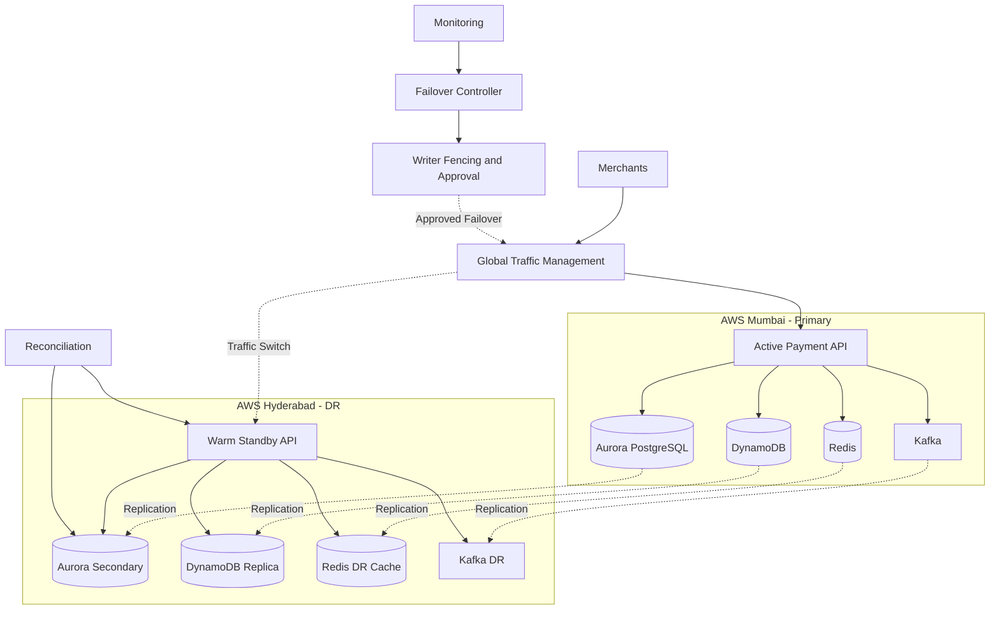

# PaySecure Gateway - Multi-Region Disaster Recovery Architecture

**DevOps & Cloud Engineering | AWS | Disaster Recovery | Terraform**

## Project Overview

PaySecure Gateway is a fictional payment aggregator processing 3.2 million daily transactions worth INR 500 crore across 45,000 merchants.

This project proposes a multi-region disaster recovery architecture across AWS Mumbai and Hyderabad.

## Business Requirements

| Metric | Requirement |
|---|---|
| Daily Transactions | 3.2 Million |
| Daily Transaction Value | INR 500 Crore |
| Merchants | 45,000 |
| Current Availability | 99.92% |
| Target Availability | 99.99% |
| Target RPO | Below 1 Minute |
| Target RTO | Below 5 Minutes |

## Architecture Decision

**Selected Model:** Active-Passive Warm Standby

- Primary: AWS Mumbai (ap-south-1)
- DR: AWS Hyderabad (ap-south-2)
- Single authorised payment writer.
- Controlled failover with writer fencing.
- Cross-region data replication.

## Project Status

In Progress - Proposed architecture; implementation and recovery targets pending validation.

## High-Level Architecture

## Technology Stack

- Cloud: AWS
- Infrastructure as Code: Terraform
- Containers: Docker
- Database: Aurora PostgreSQL and DynamoDB
- Cache: ElastiCache Redis
- Messaging: Apache Kafka
- Monitoring: CloudWatch
- Version Control: Git and GitHub

## Project Deliverables

- [x] Business Requirements Document
- [x] Architecture Decision Record
- [x] Architecture Overview
- [x] Component DR Strategy
- [x] Architecture Diagram
- [ ] Terraform implementation
- [ ] Local DR simulation
- [ ] 12 DR runbooks
- [ ] Compliance mapping
- [ ] Automated testing and evidence
- [ ] Review Board presentation

## Disclaimer

This is a fictional payment-system portfolio project. The architecture is proposed. Production deployment and RPO/RTO achievement have not yet been demonstrated.

## Author

**Divya Mesare**

GitHub: https://github.com/Divyamesare

LinkedIn: https://www.linkedin.com/in/divya-mesare-733718240/

**Project Status:** In Progress

